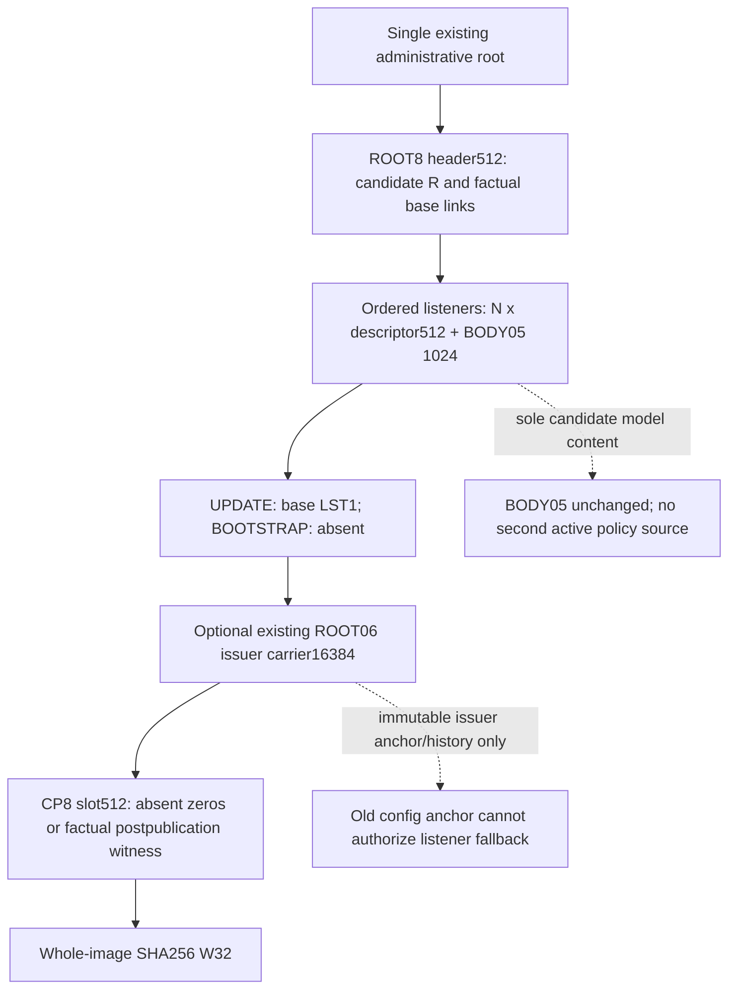

# D3 composition, compatibility and implementation handoff — PROPOSED

Exact spec is D3-REVISION3-PROPOSED.md; offset-matrix.csv and ed11-size-estimate.json are mechanically transcribed tables/arithmetic. The full combined decision and patch replace only D3 plus revision metadata; D2/D4 and all other surrounding clauses are preserved. No original proposal or accepted record edited. No new envelope is written, compiled or tested.

## Hash/transaction order

C covers exact prefix[0,Q), CP hash covers CP[0,480), W covers image[0,Q+512). New candidate is initially stored with all-zero CP. Actual durable commit -> actual CURRENT/publication/epochs -> optional checkpoint-only exact CAS. This preserves C/R and changes only CP/W. Reader never manufactures authority from any of these hashes. Absent/corrupt CP is never a shortcut to restore-as-bootstrap. AUTHORITATIVE_RECOVERY=DENY even for a valid complete CP.

## Historical compatibility matrix

| Format | Current factual domain | ROOT8 proposal behavior |
|---|---|---|
| Private BODY0.2/0.3/0.4 | Original explicit discriminators/endian/fields | Unchanged; not guessed/upgraded to BODY05. Unsupported candidate model version rejected. |
| BODY0.5 | Exact1024; original inner hash over first992; policy_epoch field remains0 | Embedded unchanged as sole candidate model encoding; full1024 SHA referenced by descriptor. No A/P inserted. |
| ROOT06 |8192-byte config anchor +8192 issuer image | Original reader/path remains unchanged. Optional byte-exact carrier only for governed issuer history; not a new active config or an automatic ROOT8 predecessor. |
| PACICP01 historical publication link |512; original BIG-ENDIAN; checks ROOT06 prefix16384 and own first480 | Not CP8. No widening its old hash domain, dropping bytes or silent reinterpretation. |
| Linked ROOT06 |16896 exact | Recognized historical, unsupported as UPDATE predecessor in first ROOT8 profile. Migration requires its own authorization/proof; do not start a second root or choose a fresh path to bypass it. |
| LST1 PACLST01 | Accepted LE/header128+N*512+32; historical R/A/P and BODY references | Embedded complete only for UPDATE base, not candidate. No zero-epoch LST1 for bootstrap. |
| New PACROOT8 / PACR8CP1 | New exact version1 discriminators | Proposed only. Unknown version, mismatched length/presence/hash, corrupt history or unsupported capability denies all dependent effects. |

## Exact implementation work after owner acceptance

1. Prepare a separately reviewed portable root-envelope codec with explicit byte reads and no allocation/Win32/CNG, using existing SHA adapter. Existing BODY/LST codecs retain byte contracts; platform adapter provides their validated models without moving authorization into hash callbacks. Keep old readers strict and new dispatcher length/version explicit.
2. Extend the SAME root participant for an owned immutable candidate collection, protected source refs and predecessor pin. Preserve no CURRENT/bootstrap fiction, D2 actor/material facts and no-op/unknown authority denial. The first actual target supports one logical listener and rejects the rest; format capacity is not runtime permission.
3. Prepare the SAME CAS/pending worker with correctly priced old/new/observed images, native identity and exact length/full-byte predecessor. No extra worker/registry/journal. Preserve all unresolved/close outcomes and buffers/credits, and Stop independent of pending worker. Root slots carry matching immutable generation tuple; old pins cannot be invalidated or overwritten.
4. Validate inline issuer carrier origin/binding separately. Existing issuer adapter must not read archived config as CURRENT. Do not claim it is ready merely because carrier bytes validate. No issuer cryptography/CA creation or recovery authorization follows from D3. ROOT06 migration is not part of this first profile.
5. Reconcile complete compiled ED11 before root integration, including C structs/pins/model buffers/material/AST/input/native hash provider/retained graphs. The arithmetic subtotal is not a reserve. Reject if budget or lifetime cannot be proved, without shrinking/dropping/evicting.

Future validation required (NOT_RUN): each header offset/bound; exact formula across N/B/J; explicit absence; every reserved byte; nonoverlap/trailing/overflow; ordered identity duplicates; descriptor/BODY divergence; LST references to base vs candidate; issuer history/high-water/revocation regressions; bootstrap false positives/creation race; stale pin/full-byte CAS conflict/UNKNOWN; commit before publication; CP-only transition invariant C/R with changed W; crash before/after commit/CURRENT/CP; mixed generations/retention/Stop/slots; unknown historical/new discriminators; all gates still closed. Synthetic fixtures, native file/transaction evidence and actual operational proof must be reported separately. No such tests/build/network execution in this task.

## Conformance and remaining gates

No material accepted-contract conflict identified in this proposed data layout: it does not change LST1, historical BODY/root/CP or bootstrap/update rules. It supplies the new versioned contract required by LST1 C1/N6, rather than editing reserved bytes. I/R/A/P and native authority remain external facts; generation tuple is correlation only. However proposed carrier adapter/migration/actual joint ED11 are NOT qualified and remain denied until their own gates. Acceptance is not permission to implement automatically. FIRST_UNRESOLVED_DIVERGENCE=OWNER_ACCEPTANCE_OF_EXACT_D3_PENDING.
