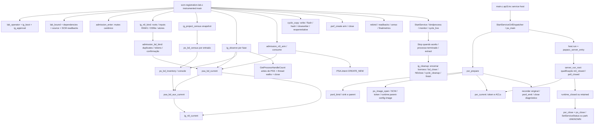

# Call graph factual e fronteiras

O ciclo positivo é fonte existente, mas os artefatos03 atuais bloqueiam sua entrada. Call graph acima não prova que foi executado. PS_NATIVE/PS_ADMISSION do qualificador e PS_NATIVE do serviço são instâncias em PROCESSOS distintos; não somar seus handles. Censo custa observações no qualificador, não na tabela do processo observado.

N0 contexto possui cinco roots, dois inputs e quatro políticas. Originais actor/control/aux/osfile são duplicados para o owner e depois fechados pelo adapter; configuration/image são emprestados, não duplicados por BD. Inventário/observer são borrowers. GetCurrentProcess/Thread e GetModuleHandle são pseudo/borrowed, não CloseHandle/FreeLibrary. SERVICE_STATUS_HANDLE não recebe CloseHandle; SC_HANDLE usa CloseServiceHandle; EVT usa EvtClose; PSS usa suas APIs próprias.

O runtime de qualificação entra em init_closed/poll_closed, managers sem Sessions/jobs ativos/listener/egress/PST ativo; não é o caminho de produção com rede. O audit segue esse ramo até readiness/Stop/recibo e cita a fronteira dos managers/providers; não afirma auditoria de recursos internos de bibliotecas/OS ou de toda composição produtiva. Nenhum CreateEvent/CreateThread explícito foi encontrado nesses owners/bridges; não se propõe trocar o Stop atômico por evento/worker. SetConsoleCtrlHandler e callback SCM podem implicar trabalho do Windows, cujo custo não foi medido.
