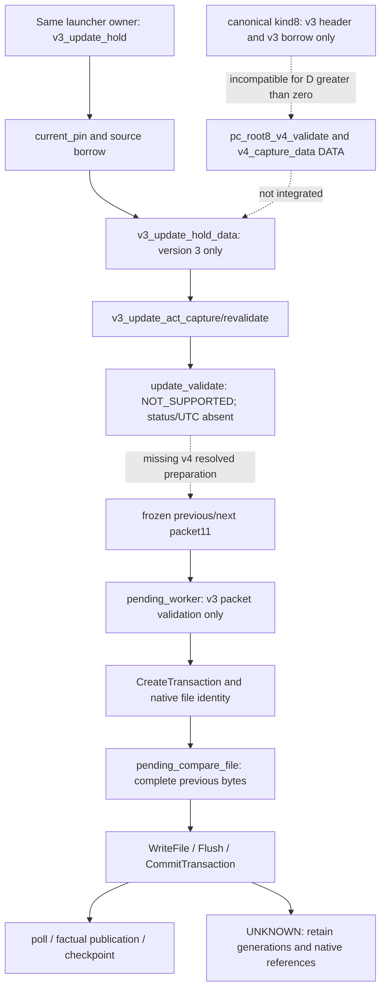

# V4 persistence: deep root-cause audit

Task PACC-PHASE6-V4-DEEP-ROOT-CAUSE-AUDIT-1. Date 2026-10-22.
HEAD/main: 913c90cf2328f7939d8f5b927640601903ac6e91.
IMPLEMENTATION_AUTHORIZED=NO. No functional source or accepted contract changed.

## A. Executive diagnosis (one page)

The root cause is an incompletely integrated, version-specific administrative
transaction assembled through several independent DATA slices, without one
closed call/lifetime/resource contract for the whole UPDATE. The claim that v4
is blocked *only* by ED11 or BCrypt is false. The cohort/act and packet11 worker
are v3-only; canonical kind8 is also v3-only; administrative resolution still
returns NOT_SUPPORTED without qualified issuer status/UTC. Those are executable
gates independent of hash memory. V4 codec/backing tests are deliberately
synthetic in parts and do not prove that these canonical paths interoperate.

BCrypt is a CONTRIBUTING_FACTOR: synchronous public integrity math is bound to
native issuer/provider ownership, creating avoidable opaque hash resources and
rehash costs. The old store03 cleanup reference-loss defect was real at source
level and has been corrected. That correction did not make provider bytes known.
store02_hash still has the old local-handle cleanup pattern on its distinct
historical path. No actual leak or native cleanup failure is established here.

ED11 is sound in separating managed memory, native categories, retained charges
and host admission. The 3 MiB ceiling is not a total Windows working-set/kernel
cap. The fixed graph fits nominally; the full transient graph is not proved.
Treating any observed process peak as a hard bound, or requiring a nonexistent
v4 positive path before authorizing a separately bounded laboratory integration,
are methodology errors. They are not evidence that the quota is inadequate.
Native opaque allocation bounds cannot be deduced from handle counts. The
accepted target-policy/measurement route exists but is not qualified/approved.

The minimum durable solution is ONE explicit prepared-storage transaction
boundary in the existing owner: version-aware DATA validation and deterministic
storage hashing separate from administrative authority/provider work; frozen
predecessor/candidate material handed to the same native worker; full-byte CAS
and factual pre-effect revalidation preserved. This is a targeted consolidation,
not a new root, provider service or rewrite. It must close known version and
candidate-access gaps and classify per-phase resources before worker attachment.
BearSSL is a candidate implementation of the math portion, not the solution by
itself. Native transactions, certificate/status work and runtime resources retain
independent gates. No complete ED11 PASS or operational authority is claimed.

One next executable slice is specified in section J: an isolated storage-hash
closure qualification capsule, using pinned source and existing DATA inputs,
with all product guards left closed. It produces concrete symbol, equivalence
and stack evidence rather than another broad audit. It is NOT authorized here.

## B. Causal tree and evidential strength

```text
No qualified canonical v4 persistence
+-- Functional composition [PROVED BY CODE]
|   +-- hold_data / act_ready / packet11 accept v3 only
|   +-- kind8 signer requires v3 header and published v3 borrow
|   +-- update_commit delegates to validate, which returns NOT_SUPPORTED
|   +-- no factual status/UTC/current source supplied by DATA fixtures
+-- Architecture [PROVED DEPENDENCIES; DESIGN INTENT PARTLY INFERRED]
|   +-- public storage hash -> issuer_hash06 -> BCrypt
|   +-- one callback mixes mathematical integrity and native owner guards
|   +-- candidate ownership cannot masquerade as published snapshot pin
|   +-- repeated validation re-enters issuer/native hash layers
+-- Resources [PROVED COUNTS, UNKNOWN FULL BYTES]
|   +-- fixed copies/slots are explicit, not themselves an overrun
|   +-- caller/status/crypto/native/CRT/stack coexistence not closed
|   +-- uncertain native disposition requires retained references/credits
+-- Qualification method [DOCUMENTARY EVIDENCE]
    +-- codec/backing PASS mistaken for potential integration readiness
    +-- scenario sums mixed with measurements and target bounds
    +-- first-blocker slices never establish the remaining whole-path closure
    +-- operational proof and implementation-only proof need distinct gates
```

Technical defect versus proof gap must remain distinct. Old failed store03
cleanup lost local references: concrete ownership defect, not merely missing
telemetry. New helper preserves references and bounds repeat attempts: scoped
fix. BCrypt allocation size/failed-close disposition remains an API evidence gap.
The v3-only checks are functional limits, not environmental limitations. Status,
UTC, CURRENT and operator authorization are independent security facts, not
things a checksum or memory reserve can manufacture.

No demonstrated contradiction requires changing accepted ED11. Section11.3
expressly permits representing UNKNOWN as denial while implementation proceeds.
TS0-TS8 requires complete coexistence/prepatch proof for dependent attachment;
that restriction still binds. A staged laboratory capsule is not attachment.
If attachment continues to require a universal opaque native maximum that the
available target APIs do not expose, the focal normative question is a pinned
measurement/host-credit/freshness uncertainty policy, not a larger managed cap.
No such exception is accepted by this report.

## C. Real execution graph and missing links

[Execution/resource graph](execution-graph.md) records inputs, owners, lifetimes,
resources, errors, effects and requirements per stage. Key ordering correction:
full-predecessor comparison/native identity CAS happens INSIDE the native
transaction BEFORE WriteFile and CommitTransaction, not after commit. A later
checkpoint-only transaction records post-publication facts. Neither CP4 nor a
valid digest can create CURRENT/A/P before factual publication.



V4 kind9 strict Ed25519 DATA is implemented. It does not specialize kind8,
cohort, CP3 checks or worker versions automatically. In particular,
server_config_root8_signer_win32.c:35 rejects header version4, and
server_config_root8_data_win32.c:84/98 uses v3_borrow_data. V4 shape invokes
pc_root8_pdg_records_data, which calls kind8 for delegation records. Therefore
D>0 cannot be qualified through that canonical v3-only adapter merely because
kind9 passes. Tests/config_root8_v4_test.c:16-17 delegates to component3;
component3 in tests/config_root8_v3_test.c:16-17 explicitly models kind8 by length.
This is valid declared DATA testing, not a native kind8-v4 proof.

The candidate/pin cycle is equally concrete: cohort candidate backing serial is
zero, while pinned_signer requires published G7 protected ranges and a real pin.
The missing bridge is an explicit candidate-owned DATA validation view with
factual operator/source resolution, NOT a fabricated candidate pin. A precommit
candidate is never required to be CURRENT; only its predecessor is. This is an
implementation integration gap under the existing ownership contracts.

## D. Historical reconstruction

[History and evidence](history-and-evidence.md) distinguishes Git provenance from
mutable handoff chronology. All first reachable committed storage/worker versions
are in the single 913c90c commit (2026-10-21, message phase 6); its parent lacks
these files. It cannot prove per-function development chronology inside that
commit. Later papacc_store_hash and generic backing_capture_data_version changes
are WIP, not separately committed history. Newer v4 sources are untracked WIP.
Document task IDs/patch manifests provide narrower provenance, not invented
intermediate commits. History-evidence.json preserves exact Git pickaxe results.

## E. Hashing responsibilities, repetition and safe reuse

Why backing_capture_data_version uses issuer_hash06: the portable codec accepts
a generic SHA callback, the native root already had an owner-bound implementation,
and later backing code supplies that function directly. The dependence is proved;
that it was the author's convenience choice is an inference, not a Git rationale.
No inspected accepted hash domain requires BCrypt or issuer authority to compute
SHA-256 of public bytes. Ownership and CURRENT guards are necessary; mathematical
hashing and authorization need not be the same callback.

Repeated whole-packet/CA hashes occur at capture, borrow and act matching;
checkpoint_match calls borrow, while act_revalidate calls match before/after
native identity inspection. Within a single serialized act-capture/revalidate
chain, the same candidate/base bytes can be processed repeatedly. The exact
runtime count depends on guards and prior state; no profiling count is invented.

Not all repeated-looking hashes are redundant: SHA(packet[0,n-32)) trailer,
SHA(packet[0,n)) backing identity, SHA(prefix before CP), SHA(CP[0,480)), source
key fingerprint and component checksums use different bytes/domains and must
remain byte-exact. Domain equality must be established before sharing a result.

Possible safe reuse: store a validation result associated with exact owner/slot
serial, bytes/length/domain, protected lifetime and validator/backend revision in
the SAME operation. Reuse is allowed only while mutation is excluded and the
accepted corruption model still holds. It cannot replace external status/UTC,
operator revalidation, native file identity or full-byte CAS. Current tests
intentionally mutate backing bytes and expect the next borrow to reject; simply
removing rehash would violate that behavior. Any reduced corruption-detection
scope requires a focal normative decision, not a cache boolean. Rehash is cheap
deterministic public math after a backend split; retaining it initially is lower
risk than changing the integrity model for a few hash calls.

The right responsibility boundary is: codecs define bytes/domains and validate
structure; a private portable math adapter implements SHA; storage owns protected
material, error/Stop gates and transaction identity; issuer/status providers own
certificate/administrative facts. A small private callback split can preserve
ROOT06/v2/v3/v4 APIs/bytes; no general mathematical service is needed.

## F. BCrypt: actual problem versus incomplete evidence

Current papacc_store_hash stores algorithm/hash references directly in durable
contexts. Normal creation/hash/finalization followed by confirmed Destroy/Close
clears them; failed cleanup retains them and denies output/reuse. Two contexts
bound four references, plus the distinct preexisting issuer pair: conservative
six named references, not six kernel handles or known byte allocations. Stop
sets flags; it does not cancel Windows native work or release uncertain objects.
No native failure or leak is alleged from controlled-shim tests.

store02_hash still keeps local handles and returns after failed destroy/close.
That historical path retains the source-level reference-loss risk fixed in
store03. It is not reachable by merely comparing v3/v4 predecessor bytes, and
is not authority to broaden this audit into a functional patch. It must not be
used as an unreviewed fallback. Record it as a separate demonstrated code-path
nonconformance to retained-ownership requirements, not a proven running leak.

Another contributor: backing_borrow_data_version acquires the root lock and
calls issuer_hash06 before releasing it; papacc_configuration_stop later acquires
that lock after setting atomic flags. Stop signalling is early, but synchronous
return/lock acquisition has no demonstrated provider latency bound. No runtime
hang was observed. This is a real call/lock dependency requiring proof or moving
native work outside the lock with pinned revalidation; not evidence to declare
Stop destroyed resources. A deterministic hash reduces this particular exposure
without qualifying every native call or the whole Stop path.

CryptHashCertificate2 and CryptVerifyCertificateSignatureEx remain in certificate
validation. Native token checks, BCryptGenRandom, TxF and CRT remain separate even
after storage SHA replacement. Moving hashes to a different module cannot erase
them from the target ledger. Source-level no-provider hash closure would remove
real resources only at the replaced hash call sites; it would not make Windows
transactional persistence deterministic in all native categories.

## G. ED11: correct scope, excess conservatism and real limits

[Resource diagnosis](resource-diagnosis.md) reconciles the graph. Explicitly
Selected managed cap3,145,728 applies once per Accelerator process, not per
operation/phase. Default/Legacy2,097,152 stays unchanged. User/kernel incremental
32/8MiB are candidates beyond a factual baseline, not qualified reserves, not
managed cap components or RAM minima. Full-process WS/private commit, shared
mappings and kernel quota counters overlap and cannot be summed blindly.

Current compiled known managed1,952,704 and minimum projected v4 known1,956,448
leave nominal fixed-layout differences1,193,024 and1,189,280. They are not full
peaks/margins. The old3,813,017 scenario is not proved simultaneous consumption;
it neither proves an actual overrun nor permits declaring PASS. Existing
65,536 worker-stack and8,192 checkpoint reserve are already charged. Root/commit/
pending/slots are nested; pin counts do not duplicate entire material images.

Model E retention is necessary for uncertain effects. Three slots and frozen
previous/next are deliberate isolation, not automatically wasteful. Unnecessary
coexistence may instead arise from keeping DER/status/acquisition scratch after
synchronous validation or storing the same immutable CA twice. No such release
credit is proved by this audit. Current capture already reuses the CA decode
arena for BODY decode after native borrows end: preserve that proven optimization.
The 512-byte compare scratch already replaced a redundant full observed image.

The qualification bottleneck is not an established memory overflow. It is an
unclosed resource/lifetime graph plus insufficient target evidence for opaque
allocations, nested stack and native/runtime/host categories. No available local
proof establishes universal provider/kernel maxima; absence of such evidence is
not a theorem that all target qualification is impossible. ED11 allows a separately
approved evidence-backed target uncertainty policy, currently absent. A focal
clarification should distinguish implementation-only bounded DATA experiments
from target admission, state categories/attribution and specify the empirical
policy if chosen. It must keep UNKNOWN explicit and admission denied until all
required conditions pass. No quota, recovery, authority or safety clause change
is justified by the audit.

## H. Alternatives, priority and backup

[Alternatives matrix](alternatives.md) compares A-J, risk, portability, changes,
resource effects and required proofs. One primary recommendation: consolidate
a version-aware, resource-closed prepared-storage boundary under the same owner,
with private deterministic SHA and a separate authority revalidation path. Keep
initial rehashes and all CAS comparisons. Do not rewrite persistence or generic
issuer cryptography. No whole-path PASS follows until v4 versions, candidate
validation and operational native/category evidence are actually closed.

Backup ONLY if the minimal pinned BearSSL hash closure fails provenance,
VC6/equivalence or bounded-stack gates: qualify the pure-C SHA-256 path from the
already independently pinned OpenSSL3.5.8 archive, without EVP/provider/assembly
runtime dependencies. This is not permission to import OpenSSL wholesale or
reimplement rounds. It solves the same math boundary, not native transactions.
Keeping BCrypt is containment, not the preferred permanent storage dependency;
a new journal/helper process/transaction engine is unjustified by current data.

If starting today: keep the single root, revisions/pins, formats, worker and native
CAS, but design the prepared descriptor and version dispatch first. Validate
bounded public data with a provider-free math dependency; freeze owner material;
carry typed factual authority observations separately; revalidate identity/status
before the existing worker effect. That avoids teaching storage hashing to act
as an issuer service and avoids reusing published-pin APIs for private candidates.
Small migration: split callbacks, preserve redundant integrity initially, add
explicit v3/v4 validation branches, then qualify native admission. No full rewrite
is warranted while the known fixed graph fits and existing CAS tests pass.

## I. Minimal correction plan and PASS/STOP criteria

1. Close the storage-hash capsule (section J). Files: store03/hash helper,
   legacy digest storage call sites, storage uses of issuer_hash06, private build
   binding. PASS exact domains/bytes, no provider in capsule call closure, actual
   VC6/modern builds, bounded caller/context/stack. STOP on provenance/symbol,
   equivalence/lifetime/Stop failure. No historical issuer API replacement.
2. In the existing cohort/data adapters, implement explicit v4 version handling
   and candidate-owned validation view. Files: v3_update_cohort/act/backings,
   root8_data/signer, pending header/guard and config_root8_v4 consumers. PASS
   canonical D>0 kind8-v4 integration and v3/v4 predecessor/CP preservation under
   protected lifetimes; no synthetic callback substituted for canonical proof.
   STOP on invented pin/authority, unsupported source or history loss.
3. Attach factual issuer/status/qualified UTC and operator observations only
   when available, revalidate before effect. Missing sources remain DENY while
   independent DATA/native tests continue. No false environment-only diagnosis.
4. Close exact category/phase resource bounds and target admission policy;
   qualify same worker packet/version handling and native CAS/UNKNOWN/Stop.
   PASS only complete applicable budget/host evidence with original quotas;
   no nominal margin or synthetic CURRENT used as authorization.

These are dependency-ordered correction stages, not a list of new broad audits.
They require separate explicit implementation/executor approval. No step removes
accepted guards to make the next test return success.

## J. One next executable slice

Proposed task: CANONICAL_STORAGE_HASH_CLOSURE_LAB_QUALIFICATION.
Deliver one unlinked-to-product, isolated, Accelerator-owned storage hash capsule
with an exact approved source/package manifest and explicit private storage
callback boundary. Acquire/verify official BearSSL pin first within that same
slice; if provenance fails STOP, not a new library search. No Browser/PST writes.

Inputs: public historical codec images/vectors already authorized, not new keys,
certificates, CURRENT or .papacc fixtures. Call closure: SHA math plus span/Stop/
output handling, exercised for store03 and storage-only legacy/issuer hash use.
Keep issuer/signature/status APIs untouched. No root registry/worker is created.

Required experiment: same images and chunk boundaries through existing BCrypt
reference and candidate math, empty/55/56/63/64/65/multiblock/large KATs, Stop and
failure/no partial output; compare all persisted digest bytes. Inspect dedicated
object/linked capsule symbols and imports, not whole server imports; require zero
reachable BCrypt/CryptHash/EVP calls from this capsule and no hidden allocation.
Measure context, nested stack, code/const data, CRT/compiler helpers and two-context
coexistence in actual VC6 and modern Debug/Release. Retained old native resources
are not reset or reused. Record exact deltas and remaining native gates.

This one discriminating slice tests whether avoidable storage math opacity can
be eliminated without changing integrity or authority. Failure selects the stated
backup only at its concrete gate. Success authorizes no v4 persistence: it supplies
the missing deterministic component proof for the ordered plan above. It is more
useful than another whole-process peak measurement with mixed provider call paths.

## Diagnostics performed and limits

Read-only Git pickaxe/show, real static call/guard analysis, and dumpbin imports/
symbols were performed. Existing local Debug/Release each pass5 selected CTests
(root8.v4 DATA, v4 backings, hash lifetime/owner, census); no new executable source
or build was produced. Worker fixture imports BCrypt and ktmw32 transaction APIs;
that corroborates native dependency, not dynamic reachability of every import.
Static call sites prove reachable hash paths. Passing model tests does not prove
canonical kind8-v4 or actual CURRENT/UTC. No new native failure injection,
certificate/CURRENT generation, network, clock change, clone/worktree or git
publication occurred. Input hashes and final preservation evidence are adjacent.
